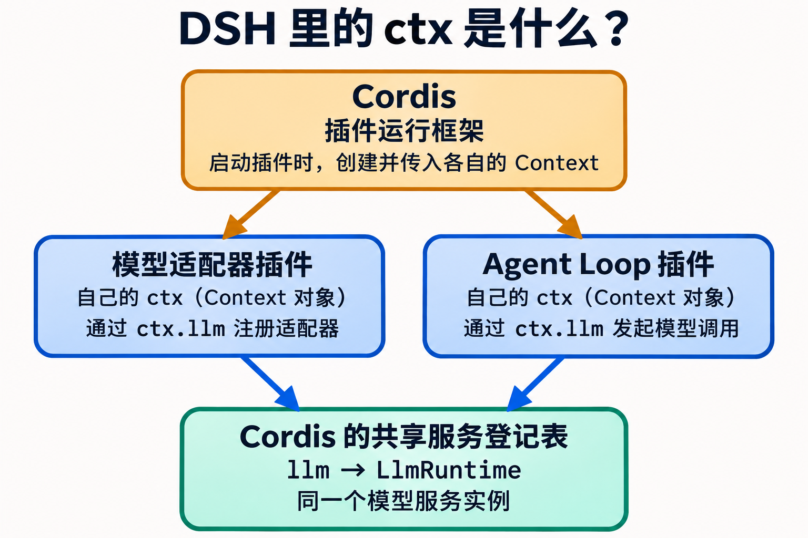

# 从 `ctx.llm` 看懂 DSH 的模型插件化架构

在 DeepSeek Harness（DSH）里，如果我们要让模型回答一句「你好」，要先弄清楚**模型从哪里来、这次选哪个模型、请求怎样发出去并拿到结果**。最小的模型调用可以从两个插件看起，即 `dsh-llm` 和 `dsh-llm-pi-ai`。把它们和 Agent Loop 接起来后，还可以继续看失败时怎样重试。

下面以本地 DSH 源码提交 `4b399c39a6` 为例。请求里的 `provider: 'lab'` 会贯穿模型接入部分，我们沿着它来看从登记到实际发请求会经过哪些代码。

## 1. API 是什么

**API 是软件向其他代码提供的接口，以及使用这些接口时可以依赖的约定。** 写程序时，函数和方法会互相调用。具体到一个模块想用另一个模块的能力，它需要知道三件事，即该调哪个方法、传什么进去、会得到什么。接口还约定这些操作实际会怎么表现。

- **同一个程序内部也有 API。** Agent Loop 和 `dsh-llm` 在同一进程里。Agent Loop 写 `ctx.llm.stream(options)`，就是在调用进程内 API。
- **API 也包括事件。** 其他插件可以订阅 `llm/models-updated`。事件名、触发时机以及随事件交付的数据，都是它们要理解的约定。
- **函数签名和行为都属于约定。** `stream(options)` 的签名说明怎样传参和读返回值。流的行为还约定了正文逐块到达，最终收到 `finish`。如果函数签名照旧，流却提前结束并漏掉 `finish`，依赖终态的调用方就可能出错。

所以理解一个 API 时，要先把调用方和提供方对上。**API 调用方**按约定传入数据，并处理返回值、事件或错误。**API 提供方**开放接口，并负责让实际行为符合约定。拿 `ctx.llm.stream(...)` 来说，Agent Loop 是调用方，`dsh-llm` 是提供方。等 `dsh-llm` 把请求交给已注册的适配器，它又成了适配器接口的调用方。换句话说，要看当前是谁在调用哪个接口。 [DSH 流协议](https://github.com/deepseek-ai/deepseek-harness/blob/4b399c39a6d1479cd84ca591b4d7c88e24d38a96/docs/subsystems/llm-streaming.zh.md)

## 2. Cordis、`ctx` 和 `ctx.llm` 是什么关系

**Cordis 是 DSH 用来装配和运行插件的框架。** DSH 把 Agent Loop、模型接入、工具注册和会话记录等能力拆成插件，再通过配置组合这些能力。这就是这里所说的插件化架构。Cordis 的上游开源项目是 `cordiverse/cordis`，DSH 将上游源码引入自己的仓库，再维护本地修改。 [DSH 架构](https://github.com/deepseek-ai/deepseek-harness/blob/4b399c39a6d1479cd84ca591b4d7c88e24d38a96/docs/architecture.zh.md#cordis) · [DSH 的上游源码清单](https://github.com/deepseek-ai/deepseek-harness/blob/4b399c39a6d1479cd84ca591b4d7c88e24d38a96/vendor/README.md#manifest)

`ctx` 是插件收到的一个变量，指向 Cordis 提供的 `Context` 对象。每次挂载插件，都有自己的 `ctx`。同一个插件包挂载两次，就会得到两个上下文。**`ctx.llm` 可以读成「通过这个上下文，取出名为 `llm` 的服务」。** 同理，`ctx.tools` 取工具服务，`ctx.sessions` 取会话服务。在同一个服务作用域里，两个插件可以用各自的 `ctx` 访问同一个底层服务。 [Cordis 上下文与作用域](https://github.com/deepseek-ai/deepseek-harness/blob/4b399c39a6d1479cd84ca591b4d7c88e24d38a96/docs/cordis-api/context.zh.md)



### 用 `SessionController` 看懂包、类和对象

在 Web 装配里，`dsh-api-session-controller` 是插件包名。包的入口是 `SessionController` 类。Cordis 挂载它时会创建这次挂载自己的 `ctx`，把它作为构造函数的第一个参数。`new SessionController(...)` 创建出存在于后端进程内存里的对象，构造流程以 `sessionController` 为名注册这个对象，其他插件就可以通过 `ctx.sessionController` 找到它。**类定义对象怎样构造和工作，对象是类的一个实例，服务名是 Cordis 查找这个对象时用的名字。** [Web 装配清单](https://github.com/deepseek-ai/deepseek-harness/blob/4b399c39a6d1479cd84ca591b4d7c88e24d38a96/packages/bundle/web-app/cordis.patch.yml#L117) · [SessionController 构造函数](https://github.com/deepseek-ai/deepseek-harness/blob/4b399c39a6d1479cd84ca591b4d7c88e24d38a96/packages/api/session-controller/src/index.ts#L152)

### `inject` 和 `apply` 是干什么的

`inject` 告诉 Cordis 本插件启动前需要哪些服务，`apply` 写的是这些服务就绪后插件要做什么。具体地，一个只想在启动时查看模型接入的函数式插件可以这样写：

```ts
export const inject = ['llm']

export function apply(ctx: Context) {
  const providers = ctx.llm.listProviders()
  console.log(providers)
}
```

1. `inject = ['llm']` 声明一个必需依赖，即插件需要名叫 `llm` 的服务。Cordis 读到这个声明后，会等服务就绪。
2. `apply(ctx: Context)` 是插件作者写的启动函数。条件满足后，由 Cordis 调用它，并把这次挂载的上下文传进去。这里 `ctx` 是参数名，`Context` 是参数类型。

需要注意的是，Agent Loop 也把 `llm` 声明为必需服务。如果装配中还没有发布 `llm` 的插件，它就停在 `PENDING`。对于「有了就用」的可选服务，插件可以用 `ctx.get(...)` 查询。服务后来注册后，只要作用域允许访问，已经启动的插件就可以用原来的 `ctx` 再查一次。 [Agent Loop 的依赖声明](https://github.com/deepseek-ai/deepseek-harness/blob/4b399c39a6d1479cd84ca591b4d7c88e24d38a96/packages/core/agent-loop/src/index.ts#L291) · [Cordis 服务依赖教程](https://github.com/deepseek-ai/deepseek-harness/blob/4b399c39a6d1479cd84ca591b4d7c88e24d38a96/docs/cordis-tutorial/03-services.zh.md)

## 3. 两个模型插件各自做什么

### `dsh-llm` 提供公共模型调用服务

以 `dsh-llm` 的真实源码来看，写这个插件就是写一个 `LlmRuntime` 类，让 Cordis 创建它，再把其他插件要调用的方法写在这个类上。顺着发布服务、登记适配器和分派请求这三个动作，就能读懂它的结构。

```ts
export class LlmRuntime extends TypertRemoteService {
  private adapters = new Map<string, AdapterRegistration>()

  constructor(ctx: Context) {
    super(ctx, 'llm')
  }
}

export default LlmRuntime
```

- `export default LlmRuntime` 把这个类作为插件入口导出。Cordis 加载包后，会用这次挂载的 `ctx` 创建类实例。
- `constructor(ctx)` 是这个类式插件的启动入口。具体地，`super(ctx, 'llm')` 调用父类构造函数，最终把当前实例以 `llm` 为名登记。其他插件随后通过 `ctx.llm` 取得这个服务。
- `adapters` 是这个实例维护的登记表。`Map<string, AdapterRegistration>` 表示用字符串接入名做键，用登记记录做值。

这个类还实现了 `registerAdapter(...)` 和 `stream(options)`。前者接收接入名和适配器，后者接收 Agent Loop 已经选好的 `provider`、`model` 和消息，再按接入名分派。 [LlmRuntime 源码](https://github.com/deepseek-ai/deepseek-harness/blob/4b399c39a6d1479cd84ca591b4d7c88e24d38a96/packages/llm/llm/src/index.ts#L336)

### `dsh-llm-pi-ai` 把 pi-ai 接到模型服务上

`dsh-llm-pi-ai` 的完整 npm 包名是 `@deepseek-ai/dsh-llm-pi-ai`。可以类比 Python 的 `pip install requests`，其中 `requests` 就是包名。npm 的作用域包名可以写成 `@组织/包名`。如果用 Python 项目的命名习惯来表达，类似的名字可以写成 `deepseek-ai-dsh-llm-pi-ai`。

这里的三个名字分别指不同的对象。

| 名字 | 是什么 | 做什么 |
|---|---|---|
| `pi-ai` | Pi 项目的模型调用库 | 封装 OpenAI、Anthropic 等模型 API 的请求细节。 |
| `PiAiAdapter` | DSH 编写的适配器类 | 接收 DSH 格式的请求，交给 pi-ai 执行，再把结果转换成 DSH 的流式分片。 |
| `dsh-llm-pi-ai` | Cordis 加载的模型接入插件 | 读取接入配置，创建 `PiAiAdapter` 实例，把它登记到 `ctx.llm`。 |

插件源码声明的名字是 `llm-pi-ai`，通过 `inject = ['llm']` 声明依赖，再在 `apply(ctx, config)` 里创建适配器。需要注意的是，插件自己发布的 Cordis 服务名这一栏为「无」，它把接入记录登记到已有的 `ctx.llm` 上。 [插件入口和适配器创建](https://github.com/deepseek-ai/deepseek-harness/blob/4b399c39a6d1479cd84ca591b4d7c88e24d38a96/packages/llm/llm-pi-ai/src/index.ts#L97) · [PiAiAdapter 实现](https://github.com/deepseek-ai/deepseek-harness/blob/4b399c39a6d1479cd84ca591b4d7c88e24d38a96/packages/llm/llm-pi-ai/src/adapter.ts#L283)

## 4. 一条接入怎么登记

**一条接入是一份可命名的模型网关配置。** 例如，可以把自建网关的接入命名为 `lab`。配置指定网关地址、API 协议、凭证从哪里取，以及这一接入可以调用的模型。下面是放在插件 `config` 下的一段示例，域名和模型名用来演示。

```yaml
providers:
  lab:
    baseURL: https://gateway.example.com/v1
    api: openai-completions
    apiKeyEnv: LAB_API_KEY
    models:
      - id: my-model
```

`LAB_API_KEY` 是凭证引用的名称。实际发请求时，插件会解析这个引用。想把接入改名为 `my-provider`，就在配置键、注册用的接入名和调用时的 `provider` 三处统一用这个名字。 [pi-ai 接入配置](https://github.com/deepseek-ai/deepseek-harness/blob/4b399c39a6d1479cd84ca591b4d7c88e24d38a96/packages/llm/llm-pi-ai/README.zh.md#配置提供方路由)

### `ctx.llm.registerAdapter(['lab'], adapter)` 怎么读

插件读到配置后，可以这样把 `lab` 登记给已有的适配器。

```ts
const registration = ctx.llm.registerAdapter(['lab'], adapter)
```

| 代码 | 含义 |
|---|---|
| `ctx.llm` | 从 Cordis 上下文取得名叫 `llm` 的模型服务对象。 |
| `.registerAdapter(...)` | 调用服务提供给接入插件的进程内 API，把接入登记进服务自己的表。 |
| `['lab']` | 第一个实参，是接入名数组。这里有一个元素 `lab`。 |
| `adapter` | 第二个实参，是已经创建好的适配器对象。 |
| `registration` | 调用返回的注册句柄，可用于撤销登记或替换它持有的接入集合。 |

这里要区分调用代码和方法实现。主动写下并执行这行调用的是 `dsh-llm-pi-ai`，即把 `['lab']` 和 `adapter` 作为实参传过去。`LlmRuntime` 实现 `registerAdapter`，收到实参后把对应关系写进自己的表。换句话说，**登记成功就是表里已经有 `lab → adapter` 这条记录**。可以用 `listProviders()` 检查这一步。要确认接入真的跑通，还要实际发一次请求，看看网关能否连通、凭证是否有效，以及网关是否接受指定的模型。 [适配器登记及句柄](https://github.com/deepseek-ai/deepseek-harness/blob/4b399c39a6d1479cd84ca591b4d7c88e24d38a96/packages/llm/llm/src/index.ts#L383)

### 两处名为 `adapter` 的代码有什么关系

插件先创建对象，再调用注册方法。下面是源码的简化摘录。

```ts
const adapter = new PiAiAdapter({ profiles, resolveApiKey, auth /* 还有其他配置 */ })

ctx.llm.registerAdapter(routes, adapter)
```

```ts
registerAdapter(providers: string[], adapter: LlmAdapter): AdapterRegistrationHandle
```

| 在哪里 | `adapter` 指什么 |
|---|---|
| 调用处 `registerAdapter(routes, adapter)` | 插件里的局部变量。TypeScript 从 `new PiAiAdapter(...)` 推断变量的类型是 `PiAiAdapter`。`routes` 是从配置得到的接入名数组。 |
| 方法声明 `registerAdapter(providers: string[], adapter: LlmAdapter)` | 方法的第二个参数名。声明类型是 `LlmAdapter`，因此也能接收符合这个抽象类约定的其他适配器。 |

`LlmAdapter` 定义的是各适配器都应遵循的契约，要求实现 `stream()`。`PiAiAdapter extends LlmAdapter`，所以它的实例可以传给这个参数。拿到这个对象并调用 `adapter.stream(...)` 时，实际执行的是对象所属具体类提供的方法。用哪个协议发请求，是这个具体实现的职责。 [适配器抽象类](https://github.com/deepseek-ai/deepseek-harness/blob/4b399c39a6d1479cd84ca591b4d7c88e24d38a96/packages/llm/llm/src/index.ts#L190) · [注册调用位置](https://github.com/deepseek-ai/deepseek-harness/blob/4b399c39a6d1479cd84ca591b4d7c88e24d38a96/packages/llm/llm-pi-ai/src/index.ts#L346)

### 一个适配器怎样服务两个接入

同一个 `dsh-llm-pi-ai` 插件可以配置多个接入。比如下面这两条。

| 接入名 | 网关 | 协议 |
|---|---|---|
| `lab` | 自建网关 | OpenAI Chat Completions |
| `team` | 团队网关 | Anthropic Messages |

对应的登记调用如下。

```ts
ctx.llm.registerAdapter(['lab', 'team'], adapter)
```

两条记录都指向同一个适配器实例。请求写 `provider: 'lab'` 时，`ctx.llm` 用 `lab` 查适配器，适配器再用 `lab` 取地址、凭证和协议配置。请求换成 `provider: 'team'` 时，同一个适配器就读 `team` 的配置。`model` 则随请求交给适配器，指定要调用的模型。图中为便于比较，两条接入都用 `my-model` 作为示例模型 ID。


| 名字 | 它在哪一层使用 |
|---|---|
| `llm` | **Cordis 服务名。** `ctx.llm` 根据这个名字取得 `LlmRuntime`。 |
| `llm-pi-ai` | **插件名。** 包名是 `@deepseek-ai/dsh-llm-pi-ai`。 |
| `lab`、`team` | **模型接入名。** `ctx.llm` 用请求中的 `provider` 查这张表。 |
| `openai-completions` | **协议名。** 对应配置的适配器据此组装向网关发送的请求。 |
| `my-model` | **模型 ID。** 请求中的 `model` 指定在这条接入下调用哪个模型。 |

## 5. 用 `stream(options)` 发一个问题并逐块读回复

| 写法 | 怎么读 |
|---|---|
| 发起一次 Chat | 把一组消息交给模型，请它生成一次回复。 |
| `stream(options)` | `stream` 是方法名，`options` 是传进去的请求数据。 |
| `AsyncIterable<StreamChunk>` | 返回值可以迭代读取。下一条数据可能要等，`Async` 表示异步，`Iterable` 表示可以逐条取，尖括号里的 `StreamChunk` 告诉我们每次取到的是一个流分片。 |

下面沿用「2 + 3 等于多少？」这个例子。代码假设已经装配并配置了 DeepSeek 官方接入 `deepseek-official`，且该接入接受 `deepseek-flash`。如果在前面两个插件的最小组合里运行，可以把请求改成已配好的 `provider: 'lab', model: 'my-model'`。

```ts
import type { GenerateOptions } from '@deepseek-ai/dsh-llm'

const options: GenerateOptions = {
  provider: 'deepseek-official',
  model: 'deepseek-flash',
  messages: [
    {
      role: 'user',
      content: [{ type: 'text', text: '2 + 3 等于多少？' }],
    },
  ],
}

const stream = ctx.llm.stream(options)
```

从这段代码看，`messages` 是 `options` 的属性名，冒号后面的 `[...]` 是它的值，即消息数组。具体地，这里数组只有一条 `user` 消息，它的 `content` 又是一个内容块数组，里面只有一个文本块。最后一行取出 `llm` 服务，把 `options` 交给 `stream`，拿到的流可以这样读取。

```ts
let answer = ''

for await (const chunk of stream) {
  if (chunk.type === 'text-delta') {
    answer += chunk.text
    console.log(answer)
  }
}
```

`for await` 可以读成「等下一块到达，把它放进 `chunk`，再执行一次循环体」。假设这次模型把答案拆成两段：

| 收到的分片 | 代码怎么处理 | `answer` 当前的值 |
|---|---|---|
| `block-start` | 正文块开始，继续等下一条。 | `''` |
| `text-delta`，内容是「等于」 | 把新文字拼到 `answer` 末尾。 | `等于` |
| `text-delta`，内容是「 5。」 | 把下一段文字拼到末尾。 | `等于 5。` |
| `block-end`，然后是 `finish` | 正文块结束，随后整个流结束。 | `等于 5。` |

流里还可以有推理增量、工具调用增量、用量和错误终态。示例只打印正文增量，所以不会把 `block-end` 携带的完整内容重复拼进去。完整调用方会另外处理 `finish`，判断是正常结束、请求工具、输出达到上限、取消还是出错。 [请求与流分片类型](https://github.com/deepseek-ai/deepseek-harness/blob/4b399c39a6d1479cd84ca591b4d7c88e24d38a96/packages/llm/llm/src/types.ts#L487)

### `prepareCall(config, signal?, configure?)` 是干什么的

`prepareCall(...)` 把这次调用要用的接入、适配器和生效配置先确定下来，再交给调用方一个只能用一次的调用对象。比如，我们要向 `lab/my-model` 发一句「你好」。

```ts
const prepared = await ctx.llm.prepareCall({
  provider: 'lab',
  model: 'my-model',
})

const stream = prepared.stream({
  ...prepared.config,
  messages: [{ role: 'user', content: [{ type: 'text', text: '你好' }] }],
})
```

1. **准备。** `ctx.llm` 用 `lab` 查到适配器，再查询 `my-model` 的能力、校验参数、填入默认值。假设适配器给这个模型配置的默认输出上限是 1,024 个 token，`prepared.config.maxTokens` 就会是 `1024`。`prepared` 同时记住这次选中的适配器。
2. **发送。** `...prepared.config` 把第一步得到的生效配置展开到请求里，再加上 `messages`。随后用 `prepared.stream(...)` 按这次确定好的适配器和配置得到结果流。

| 参数 | 含义 |
|---|---|
| `config` | 必填。指定 `provider` 和 `model`，也可以传 `maxTokens`、`temperature` 等生成参数。 |
| `signal?` | 可选。用来取消准备过程，例如查模型能力时用户按下取消。 |
| `configure?` | 可选。给一个函数，让它根据查到的模型能力调整生成参数，例如设定这次的输出上限。 |

这两个入口的差别在于调用方能否在准备好请求后先做一步自己的处理。具体地，`ctx.llm.stream(options)` 一次交齐模型、消息和参数，由模型服务在调用过程中查适配器、校验参数，直接返回可读的流。用 `ctx.llm.prepareCall(config)` 时，调用方可以先读 `prepared.config`，再调用 `prepared.stream(...)`。Agent Loop 选择这种写法，因为它要先记录真正生效的配置，再用同一个对象按这份配置发请求。即使两步之间有人更新了接入，记录和发送也仍然对应同一次准备结果。两种入口得到的流都可以用 `for await` 读。 [prepareCall 源码](https://github.com/deepseek-ai/deepseek-harness/blob/4b399c39a6d1479cd84ca591b4d7c88e24d38a96/packages/llm/llm/src/index.ts#L942) · [Agent Loop 记录请求配置](https://github.com/deepseek-ai/deepseek-harness/blob/4b399c39a6d1479cd84ca591b4d7c88e24d38a96/packages/core/agent-loop/src/agent.ts#L645)

## 6. 放回 DSH 的完整模型域

### 模型从哪里来

`dsh-llm-pi-ai`、`dsh-llm-deepseek-api-key` 和 `dsh-llm-deepseek-account` 都是模型接入插件，适用场景不同。它们共同做的事是把接入名和适配器登记到 `ctx.llm`。具体地，各自处理的渠道和鉴权方式如下。

| 接入插件 | 注册到 `ctx.llm` 的接入 | 模型来源与调用方式 |
|---|---|---|
| `dsh-llm-deepseek-api-key` | `deepseek-official` | 使用 API Key 认证。官方接入可以拉取模型列表，也支持配置模型目录。 |
| `dsh-llm-deepseek-account` | `deepseek-account` | 使用登录账号的 Token 认证，并拉取该账号的模型列表。 |
| `dsh-llm-pi-ai` | 用户配置的 `lab`、`team` 等接入 | 通过 pi-ai 支持 OpenAI、Anthropic 等协议。可以用 pi-ai 自带的目录、手工填写模型，或通过端点发现模型。基础组合会挂载插件，实际接入在配置后登记。 |

公共模型服务可以与不同接入插件组合。Agent Loop 统一通过 `ctx.llm` 发请求，由请求里的 `provider` 决定走哪条接入。 [DSH 模型包一览](https://github.com/deepseek-ai/deepseek-harness/blob/4b399c39a6d1479cd84ca591b4d7c88e24d38a96/packages/llm/README.zh.md)

### `listProviders()` 的调用方是谁

Web 端的 `dsh-api-session-controller` 要给选模界面提供候选时，会先用 `ctx.llm.listProviders()` 拿到 `lab`、`team` 等接入，再逐个调用 `ctx.llm.listModels(provider.id)`。具体地，第一个方法查的是 `llm` 自己的登记表，第二个方法找到对应的适配器，再向适配器查询它公布了哪些模型。最后，Session Controller 把按接入分组的目录返回给界面。 [Web 端模型目录](https://github.com/deepseek-ai/deepseek-harness/blob/4b399c39a6d1479cd84ca591b4d7c88e24d38a96/packages/api/session-controller/src/catalog.ts#L20)

`dsh-acp` 也会调用这个方法，用它构建 IDE 里的模型选项。Web 的模型设置页通过远程接口 `ctx.remote.llm.listProviders()` 查询哪些接入已登记。 [ACP 模型选项](https://github.com/deepseek-ai/deepseek-harness/blob/4b399c39a6d1479cd84ca591b4d7c88e24d38a96/packages/acp/acp/src/model-control.ts#L116) · [Web 模型设置页](https://github.com/deepseek-ai/deepseek-harness/blob/4b399c39a6d1479cd84ca591b4d7c88e24d38a96/packages/client/ui-settings-models/src/client/store.ts#L233)

### TUI 通过 HTTP 怎么拿到目录

拿 Rust CodeAgent 举例，本文采用独立的 TUI 客户端。用户打开 `/model` 选择器时，TUI 向后台的模型目录 API 发 HTTP 请求。后台先用 `listProviders()` 列出接入，再对每条接入用 `listModels(provider.id)` 查模型，最后把目录作为 JSON 返回给 TUI。

只看接入列表时，可以举一个假设的 `GET /providers`。这里实际有两次调用。

```text
TUI ── HTTP GET /providers ──→ 后台处理函数
后台处理函数 ── 函数调用 ──→ ctx.llm.listProviders()
```

换句话说，**TUI 是后台 HTTP API 的调用方，后台处理函数是 `ctx.llm.listProviders()` 的直接调用方**。完整选模目录可以在同一个处理函数里组装，也可以把两次查询提成一个 `buildModelCatalog()`。这里说的「目录模块」，可以就是后台进程中的这个函数。

需要注意的是，「进程内」指这段代码和 `llm` 跑在同一个进程。假如把一个查询组件做成同进程插件，它可以通过自己的 `ctx.llm` 直接查。具体到 Cordis，这个插件通常通过 `inject = ['llm']` 声明依赖，再由 Cordis 在服务就绪后传入它自己的 `ctx`。

### 这次选哪个模型

DSH 的基础组合通过 `dsh-agent-default-model` 提供默认模型。Web 用户手选时，`dsh-api-session-controller` 验证 `provider`、`model` 和可选推理强度，调用 `agent.model.select(...)` 记录选择。Agent Loop 准备一次请求时，从会话选择或 Agent 的默认选项取得本次要用的接入和模型，然后交给 `ctx.llm`。 [默认模型装配](https://github.com/deepseek-ai/deepseek-harness/blob/4b399c39a6d1479cd84ca591b4d7c88e24d38a96/packages/bundle/base/cordis.patch.yml#L88) · [会话选模状态](https://github.com/deepseek-ai/deepseek-harness/blob/4b399c39a6d1479cd84ca591b4d7c88e24d38a96/packages/core/agent/src/model-selection.ts#L99)

### 怎样完成一次请求

接入和模型选好后，Agent Loop 用前面讲过的 `prepareCall(...)` 固定本次调用，再消费返回的模型流。直接调用 `ctx.llm.stream(...)` 对应一次模型尝试。要让 Agent Loop 在遇到合适的错误时重新尝试，还要装配重试插件。

如果只是直接发一条「你好」并读到回复，模型域最小组合是 **Cordis 加载 `dsh-llm` 和 `dsh-llm-pi-ai`，配好一条可用接入，再由调用代码显式指定接入和模型**。如果要在产品界面里完成一轮对话，则由 `dsh-agent-loop` 组装历史消息、消费模型流并更新会话，同时装配它所依赖的 Agent、会话、工具、系统提示与会话投影服务。

## 7. 第三个插件 `dsh-llm-retry` 怎样接进来

`dsh-llm` 负责一次模型尝试，`dsh-llm-retry` 负责失败后要不要再尝试、等多久。比如网关限流或超时，Agent Loop 报告请求失败，重试插件按该接入的策略判断。条件满足时，它先等待，再告诉 Agent Loop 重跑这一步。真正重发请求的是 Agent Loop，重跑也发生在原来那一轮对话里。 [重试插件说明](https://github.com/deepseek-ai/deepseek-harness/blob/4b399c39a6d1479cd84ca591b4d7c88e24d38a96/packages/llm/llm-retry/README.zh.md)

### `ctx.on(...)` 登记的是什么

装配时，Cordis 调用重试插件的 `apply(ctx)`，插件在里面调用 `ctx.on('agent/request-error', handler)`。这个调用的意思是，当 Agent Loop 报告一次模型请求失败时，请调用这个 `handler`。`agent/request-error` 是事件名，`handler` 是监听函数。运行时 Agent Loop 会等待它返回决定。 [监听器登记](https://github.com/deepseek-ai/deepseek-harness/blob/4b399c39a6d1479cd84ca591b4d7c88e24d38a96/packages/llm/llm-retry/src/index.ts#L241) · [Agent Loop 触发事件](https://github.com/deepseek-ai/deepseek-harness/blob/4b399c39a6d1479cd84ca591b4d7c88e24d38a96/packages/core/agent-loop/src/agent.ts#L539)

需要注意的是，`ctx.on(...)` 是 Cordis 自带的事件监听方法。Cordis 创建根 `Context` 时创建 `EventsService`，放在 `ctx.events` 上，并把 `on` 暴露到 `ctx` 上。换句话说，`ctx.on(...)` 可以理解成 `ctx.events.on(...)` 的简写。`dsh-llm` 登记的是一个以 `llm` 为名的**服务对象**，`dsh-llm-retry` 在这里登记的是一个**事件监听函数**。 [事件服务的创建](https://github.com/deepseek-ai/deepseek-harness/blob/4b399c39a6d1479cd84ca591b4d7c88e24d38a96/vendor/cordis/src/context.ts#L82) · [on 方法从哪里来](https://github.com/deepseek-ai/deepseek-harness/blob/4b399c39a6d1479cd84ca591b4d7c88e24d38a96/vendor/cordis/src/reflect.ts#L258)

| 事件接口的一部分 | 具体是什么 |
|---|---|
| 入参 | 当前 Agent、轮次 `turn`、步骤 `step`、接入名 `provider`、失败信息 `failure`、本次调用捕获的 `retryPolicy`、取消信号 `signal`。 |
| 返回值 | `{ kind: 'retry' }` 表示请 Agent Loop 重跑失败步骤。监听器也可以调用 `next()`，把处理交给其他监听器。最终返回 `undefined` 时，Agent Loop 按失败结束。 |
| 会话记录 | 开始等待前写入 `llm/retry`，等待结束后写入 `llm/retry-started`，然后返回重试决定。 |

重试插件通过 `inject = ['agents', 'sessionProjections']` 声明两个必需服务。`agents` 是 Agent 注册服务，具体失败的 Agent 由事件入参传过来。`sessionProjections` 根据会话事件恢复重试次数等状态。策略定义在模型接入上，经过 Agent Loop 随失败事件传给监听器。所以，直接调用 `ctx.llm.stream(...)` 时，调用方只消费这一次尝试的结果。 [插件依赖与会话投影](https://github.com/deepseek-ai/deepseek-harness/blob/4b399c39a6d1479cd84ca591b4d7c88e24d38a96/packages/llm/llm-retry/src/index.ts#L22) · [事件签名](https://github.com/deepseek-ai/deepseek-harness/blob/4b399c39a6d1479cd84ca591b4d7c88e24d38a96/packages/core/agent/src/runtime-types.ts#L390)

## 8. `ctx.llm` 的 API 一览

| 用途 | API | 调用方得到什么 |
|---|---|---|
| 发起一次 Chat | `stream(options)` | `AsyncIterable<StreamChunk>`，供调用方逐块读取。 |
| 准备后发起 Chat | `prepareCall(config, signal?, configure?)` | `PreparedLlmCall`。它绑定这次适配器，暴露生效配置、相应的模型能力、重试策略和一次性的 `stream(options)`。 |
| 注册协议实现 | `registerAdapter(providers, adapter)` | 注册句柄。可撤销或原子替换接入集合。同名冲突时整批失败，原注册继续服务。 |
| 查询已启用的接入和模型 | `listProviders()`、`listModels(provider)` | 已登记的接入和该接入公布的模型。 |
| 查询能力并校验调用配置 | `resolveModelInfo(provider, model, signal?)`、`resolveCallConfig(config, signal?)` | 前者返回上下文窗口、输入模态、推理强度等模型信息。后者校验参数并填入适配器提供的默认值。 |
| 支持接入设置页 | `registerConfigurableProviders(entries)`、`listConfigurableProviders()`、`registerModelDiscovery(settingsNs, discover)`、`discoverModels(settingsNs, request, signal?)` | 登记和列出可配置接入，允许对正在编辑的端点探测候选模型。 |
| 辅助查询 | `providerRetryPolicy(provider)`、`imageRequestPricing(provider, model)`、`imageRequestTarget(provider, model, image)`、`fileRequestText(ref)` | 接入重试策略、图片计量和请求限制，以及文件引用在模型请求中的文本形式。 |

`registerAdapter(...)` 和 `stream(...)` 都是供同一进程内插件使用的 API。DSH 还通过 Typert 给客户端提供了远程的 `listProviders`、`listConfigurableProviders` 和 `discoverModels`。在事件这一侧，`llm/models-updated` 供消费者刷新目录，`llm/adapters-updated` 通知接入登记变化，`llm/stream` 允许运行时插件接入模型流的调用过程。 [DSH 完整 Cordis API](https://github.com/deepseek-ai/deepseek-harness/blob/4b399c39a6d1479cd84ca591b4d7c88e24d38a96/docs/subsystems/llm-streaming.zh.md#ctxllm--llmruntime)

## 9. 这套设计怎么映射到 Rust CodeAgent

**抽象回答「调用方和实现方要约定什么」**。具体到 Rust，可以用 `trait`、请求结构体和流事件枚举表达。**插件化回答「这个实现怎样进入系统，是否需要独立装配、启停或替换」**。比如，约定可以叫 `ModelProvider` 或 `ModelAdapter`，Chat Completions 适配器是它的一个实现。当部署配置选择并挂载提供这个实现的插件时，系统才有了这条调用能力。

| 建议保留的 Rust 概念 | 对应的业务问题 |
|---|---|
| `ModelCatalog` | 有哪些模型和接入。它可以汇总企业目录与本机自定义接入。 |
| `ModelInference` | 这次实际用哪个模型、怎样完成请求。宿主先解析选模意图，推理入口用解析好的目标执行调用并返回统一的流。 |
| `ModelAdapter` | 怎样与上游 API 通信。协议实现通过插件装配，并登记给共享模型服务。 |

### 企业网关和用户自定义接入怎么装配

按 CodeAgent 这两个场景，可以设计**两个接入插件，共用一份 OpenAI 兼容协议适配器**。具体地，企业目录里的 `w3` 和用户自定义接入都可以走 OpenAI 兼容协议，因而可以共用请求编码、流式解析和通用错误转换。

| 接入插件 | 职责 |
|---|---|
| 企业网关接入 | 管理内置接入 `w3`。按企业登录态从 PromptCenter 获取模型和能力，把多个企业目录模型登记到 `w3` 下。推理时使用企业网关地址和凭证，并处理企业网关特有的请求头与错误信息。 |
| 用户自定义接入 | 管理 `lab`、`team` 等用户配置。每条接入按现行规格对应一个网关地址、一份 API Key 和一个模型 ID，支持增删改、启停和连通性测试。一个插件可以管理多条接入，配置变更后更新登记。 |

这两类接入的业务约束见 `CodeAgentDesign` 的《企业模型目录与模型升级》和《自定义模型》。

用户自定义接入和 `dsh-llm-pi-ai` 扮演同一个角色。用户填一条 `lab`，插件读取网关地址、凭证和模型 ID，将接入登记给共享模型服务。Agent Loop 后来请求 `lab/my-model` 时，就能找到对应的适配器。需要注意的是，DSH 的 pi-ai 接入支持多种协议和一条接入里的多个模型，CodeAgent 现行的自定义接入支持 OpenAI 兼容协议，每条接入配一个模型。

把它落实到验证用例，可以先配置 `lab/my-model`，发出「你好」，读到完整的 `finish`。再配置一条 `team/my-model`，确认同一个适配器能根据不同接入配置向正确网关发请求。最后接入 Agent Loop，让它继续通过共享模型服务提交已经选好的接入和模型。这三步分别检验**调用契约、适配器复用，以及 Agent Loop 能否通过同一个接口使用不同接入**。

原文 [从 ctx.llm 看懂 DSH 的模型插件化架构](https://app.notion.com/p/4240626ec1ac80599078cbe10d0e41bd)
