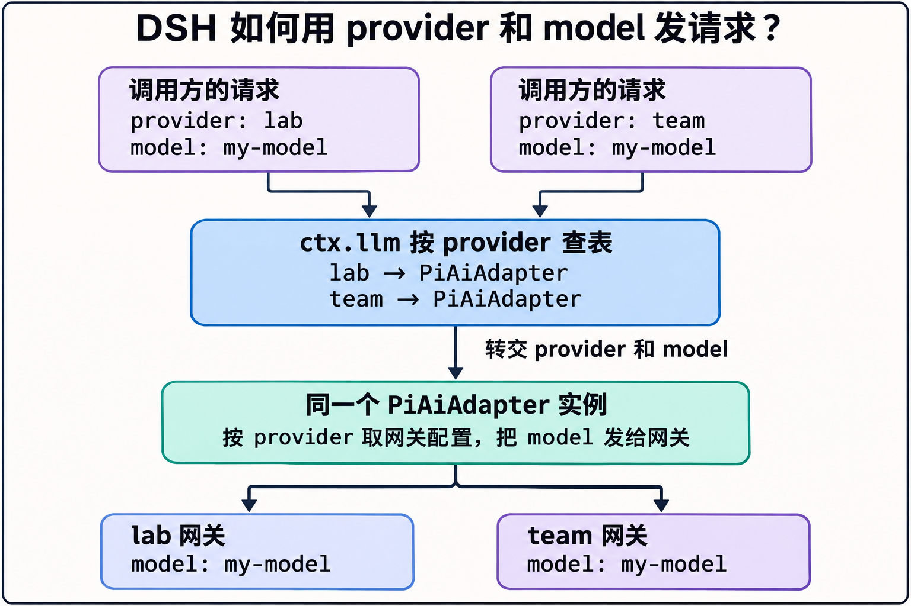

# 从 `ctx.llm` 看懂 DSH 的模型插件化架构

在 DeepSeek Harness（DSH）里，想让模型回答一句「你好」，最先要搞清楚的是三个问题：**模型从哪里来、这次选哪个模型、请求怎样发出去并拿到结果**。本文先用两个插件跑通最小的模型调用链，再说明如何把这条链接进 Agent Loop。

以本地 DSH 源码提交 `4b399c39a6` 为例。从 API 和 `ctx` 开始讲，读到最后会看到 `provider: 'lab'` 是怎么变成实际网关请求的。

## 1. API 是什么

**API 是软件向其他代码提供的接口，以及使用这些接口时可以依赖的约定。** 写程序时，函数和方法会互相调用。其他模块要使用某个方法，就需要知道该调哪个方法、传什么进去、会得到什么。这个方法和调用方可以依赖的行为，共同构成它所使用的接口。

- **同一个程序内部也有 API。** Agent Loop 和 `dsh-llm` 在同一进程里。Agent Loop 写 `ctx.llm.stream(options)`，就是在调用进程内 API。
- **API 也包括事件。** 其他插件可以订阅 `llm/models-updated`。事件名、触发时机以及随事件交付的数据，都是它们要理解的约定。
- **函数签名和行为都属于约定。** `stream(options)` 的签名说明怎样传参和读返回值。流的行为还约定了正文逐块到达，最终收到 `finish`。如果函数签名照旧，流却提前结束并漏掉 `finish`，依赖终态的调用方就可能出错。

**API 调用方**按约定传入数据，并处理返回值、事件或错误。**API 提供方**开放接口，并负责让实际行为符合约定。角色取决于正在看哪一次调用。Agent Loop 调 `ctx.llm.stream(...)` 时，`dsh-llm` 是提供方。它接着去调用已注册的适配器时，又成了适配器接口的调用方。 [DSH 流协议](https://github.com/deepseek-ai/deepseek-harness/blob/4b399c39a6d1479cd84ca591b4d7c88e24d38a96/docs/subsystems/llm-streaming.zh.md)

## 2. Cordis、`ctx` 和 `ctx.llm` 是什么关系

**Cordis 是 DSH 用来装配和运行插件的框架。** DSH 把 Agent Loop、模型接入、工具注册和会话记录等能力拆成插件，再通过配置组合这些能力。这就是这里所说的插件化架构。Cordis 的上游开源项目是 `cordiverse/cordis`，DSH 将上游源码引入自己的仓库，再维护本地修改。 [DSH 架构](https://github.com/deepseek-ai/deepseek-harness/blob/4b399c39a6d1479cd84ca591b4d7c88e24d38a96/docs/architecture.zh.md#cordis) · [DSH 的上游源码清单](https://github.com/deepseek-ai/deepseek-harness/blob/4b399c39a6d1479cd84ca591b4d7c88e24d38a96/vendor/README.md#manifest)

`ctx` 是插件收到的一个变量，指向 Cordis 提供的 `Context` 对象。每次挂载插件，都有自己的 `ctx`。同一个插件包挂载两次，就会得到两个上下文。**`ctx.llm` 可以读成「通过这个上下文，取出名为 `llm` 的服务」。** 同理，`ctx.tools` 取工具服务，`ctx.sessions` 取会话服务。在同一个服务作用域里，两个插件可以用各自的 `ctx` 访问同一个底层服务。 [Cordis 上下文与作用域](https://github.com/deepseek-ai/deepseek-harness/blob/4b399c39a6d1479cd84ca591b4d7c88e24d38a96/docs/cordis-api/context.zh.md)


### 用 `SessionController` 看懂包、类和对象

在 Web 装配里，`dsh-api-session-controller` 是插件包名。包的入口是 `SessionController` 类。Cordis 挂载它时会创建这次挂载自己的 `ctx`，把它作为构造函数的第一个参数。`new SessionController(...)` 创建出存在于后端进程内存里的对象，构造流程以 `sessionController` 为名注册这个对象，其他插件就可以通过 `ctx.sessionController` 找到它。**类定义对象怎样构造和工作，对象是类的一个实例，服务名是 Cordis 查找这个对象时用的名字。** [Web 装配清单](https://github.com/deepseek-ai/deepseek-harness/blob/4b399c39a6d1479cd84ca591b4d7c88e24d38a96/packages/bundle/web-app/cordis.patch.yml#L117) · [SessionController 构造函数](https://github.com/deepseek-ai/deepseek-harness/blob/4b399c39a6d1479cd84ca591b4d7c88e24d38a96/packages/api/session-controller/src/index.ts#L152)

插件还可以区分「必须有」和「有了就用」两种依赖。Agent Loop 在 `inject` 里写了 `llm`。服务还没就绪时，Cordis 会让它停在 `PENDING`。对于可选服务，插件可以用 `ctx.get(...)` 查询。服务后来注册后，插件仍可以通过原来的上下文再次查询到它，前提是作用域允许访问。 [Agent Loop 的依赖声明](https://github.com/deepseek-ai/deepseek-harness/blob/4b399c39a6d1479cd84ca591b4d7c88e24d38a96/packages/core/agent-loop/src/index.ts#L291) · [Cordis 服务依赖教程](https://github.com/deepseek-ai/deepseek-harness/blob/4b399c39a6d1479cd84ca591b4d7c88e24d38a96/docs/cordis-tutorial/03-services.zh.md)

## 3. 两个模型插件各自做什么

### `dsh-llm` 提供公共模型调用服务

Cordis 启动 `dsh-llm` 时，会创建 `LlmRuntime` 实例。构造函数里的 `super(ctx, 'llm')` 触发服务注册，于是其他插件可以用 `ctx.llm` 取得这个服务。`LlmRuntime` 维护一张**接入名 → 适配器**的表，并提供 `registerAdapter(...)`、`stream(options)` 等方法。接入插件登记的是接入名和适配器对象。Agent Loop 发请求时传入已经选好的 `provider`、`model` 和消息。 [LlmRuntime 源码](https://github.com/deepseek-ai/deepseek-harness/blob/4b399c39a6d1479cd84ca591b4d7c88e24d38a96/packages/llm/llm/src/index.ts#L336)

### `dsh-llm-pi-ai` 把 pi-ai 接到模型服务上

`dsh-llm-pi-ai` 的完整 npm 包名是 `@deepseek-ai/dsh-llm-pi-ai`。可以类比 Python 的 `pip install requests`，其中 `requests` 就是包名。npm 的作用域包名可以写成 `@组织/包名`。如果用 Python 项目的命名习惯来表达，类似的名字可以写成 `deepseek-ai-dsh-llm-pi-ai`。

这里的三个名字分别指不同的对象。

| 名字 | 是什么 | 做什么 |
|---|---|---|
| `pi-ai` | Pi 项目的模型调用库 | 封装 OpenAI、Anthropic 等模型 API 的请求细节。 |
| `PiAiAdapter` | DSH 编写的适配器类 | 接收 DSH 格式的请求，交给 pi-ai 执行，再把结果转换成 DSH 的流式分片。 |
| `dsh-llm-pi-ai` | Cordis 加载的模型接入插件 | 读取接入配置，创建 `PiAiAdapter` 实例，把它登记到 `ctx.llm`。 |

插件源码声明的名字是 `llm-pi-ai`，并通过 `inject = ['llm']` 取得公共模型服务。它的自有 Cordis 服务名这一栏是「无」。它贡献的是 `ctx.llm` 登记表里的接入记录。 [插件入口和适配器创建](https://github.com/deepseek-ai/deepseek-harness/blob/4b399c39a6d1479cd84ca591b4d7c88e24d38a96/packages/llm/llm-pi-ai/src/index.ts#L97) · [PiAiAdapter 实现](https://github.com/deepseek-ai/deepseek-harness/blob/4b399c39a6d1479cd84ca591b4d7c88e24d38a96/packages/llm/llm-pi-ai/src/adapter.ts#L283)

## 4. 一条接入怎么登记

**一条接入是一份可命名的模型网关配置。** 例如，可以把自建网关的接入命名为 `lab`。配置指定网关地址、API 协议、凭证从哪里取，以及这一接入可以调用的模型。下面是放在插件 `config` 下的一段示例，域名和模型名用来演示。

```yaml
providers:
  lab:
    baseURL: https://gateway.example.com/v1
    api: openai-completions
    apiKeyEnv: LAB_API_KEY
    models:
      - id: my-model
```

`LAB_API_KEY` 是凭证引用的名称。实际发请求时，插件会解析这个引用。想把接入改名为 `my-provider`，就在配置键、注册用的接入名和调用时的 `provider` 三处统一用这个名字。 [pi-ai 接入配置](https://github.com/deepseek-ai/deepseek-harness/blob/4b399c39a6d1479cd84ca591b4d7c88e24d38a96/packages/llm/llm-pi-ai/README.zh.md#配置提供方路由)

### `ctx.llm.registerAdapter(['lab'], adapter)` 怎么读

插件读到配置后，可以这样把 `lab` 登记给已有的适配器。

```ts
const registration = ctx.llm.registerAdapter(['lab'], adapter)
```

| 代码 | 含义 |
|---|---|
| `ctx.llm` | 从 Cordis 上下文取得名叫 `llm` 的模型服务对象。 |
| `.registerAdapter(...)` | 调用服务提供给接入插件的进程内 API，把接入登记进服务自己的表。 |
| `['lab']` | 第一个实参，是接入名数组。这里有一个元素 `lab`。 |
| `adapter` | 第二个实参，是已经创建好的适配器对象。 |
| `registration` | 调用返回的注册句柄，可用于撤销登记或替换它持有的接入集合。 |

**登记成功**意味着表里已有 `lab → adapter`。用 `listProviders()` 可以检查接入名是否已登记。要验证它能否真的调用模型，还要发一次请求，确认网关能连通、凭证有效，且网关接受指定的模型。 [适配器登记及句柄](https://github.com/deepseek-ai/deepseek-harness/blob/4b399c39a6d1479cd84ca591b4d7c88e24d38a96/packages/llm/llm/src/index.ts#L383)

### 两处名为 `adapter` 的代码有什么关系

插件先创建对象，再调用注册方法。下面是源码的简化摘录。

```ts
const adapter = new PiAiAdapter({ profiles, resolveApiKey, auth /* 还有其他配置 */ })

ctx.llm.registerAdapter(routes, adapter)
```

```ts
registerAdapter(providers: string[], adapter: LlmAdapter): AdapterRegistrationHandle
```

| 在哪里 | `adapter` 指什么 |
|---|---|
| 调用处 `registerAdapter(routes, adapter)` | 插件里的局部变量。TypeScript 从 `new PiAiAdapter(...)` 推断变量的类型是 `PiAiAdapter`。`routes` 是从配置得到的接入名数组。 |
| 方法声明 `registerAdapter(providers: string[], adapter: LlmAdapter)` | 方法的第二个参数名。声明类型是 `LlmAdapter`，因此也能接收符合这个抽象类约定的其他适配器。 |

`LlmAdapter` 定义的是各适配器都应遵循的契约，要求实现 `stream()`。`PiAiAdapter extends LlmAdapter`，所以它的实例可以传给这个参数。拿到这个对象并调用 `adapter.stream(...)` 时，实际执行的是对象所属具体类提供的方法。用哪个协议发请求，是这个具体实现的职责。 [适配器抽象类](https://github.com/deepseek-ai/deepseek-harness/blob/4b399c39a6d1479cd84ca591b4d7c88e24d38a96/packages/llm/llm/src/index.ts#L190) · [注册调用位置](https://github.com/deepseek-ai/deepseek-harness/blob/4b399c39a6d1479cd84ca591b4d7c88e24d38a96/packages/llm/llm-pi-ai/src/index.ts#L346)

### 一个适配器怎样服务两个接入

同一个 `dsh-llm-pi-ai` 插件可以配置多个接入。例如：

| 接入名 | 网关 | 协议 |
|---|---|---|
| `lab` | 自建网关 | OpenAI Chat Completions |
| `team` | 团队网关 | Anthropic Messages |

对应的登记调用可以理解为：

```ts
ctx.llm.registerAdapter(['lab', 'team'], adapter)
```

两条记录都指向同一个适配器实例。请求写 `provider: 'lab'` 时，`ctx.llm` 用 `lab` 查适配器，适配器再用 `lab` 取地址、凭证和协议配置。请求换成 `provider: 'team'` 时，同一个适配器就读 `team` 的配置。`model` 则随请求交给适配器，指定要调用的模型。图中为便于比较，两条接入都用 `my-model` 作为示例模型 ID。



| 名字 | 它在哪一层使用 |
|---|---|
| `llm` | **Cordis 服务名。** `ctx.llm` 根据这个名字取得 `LlmRuntime`。 |
| `llm-pi-ai` | **插件名。** 包名是 `@deepseek-ai/dsh-llm-pi-ai`。 |
| `lab`、`team` | **模型接入名。** `ctx.llm` 用请求中的 `provider` 查这张表。 |
| `openai-completions` | **协议名。** 对应配置的适配器据此组装向网关发送的请求。 |
| `my-model` | **模型 ID。** 请求中的 `model` 指定在这条接入下调用哪个模型。 |

## 5. 用 `stream(options)` 发一个问题并逐块读回复

| 写法 | 怎么读 |
|---|---|
| 发起一次 Chat | 把一组消息交给模型，请它生成一次回复。 |
| `stream(options)` | `stream` 是方法名，`options` 是传进去的请求数据。 |
| `AsyncIterable<StreamChunk>` | 返回值可以迭代读取。下一条数据可能要等，`Async` 表示异步，`Iterable` 表示可以逐条取，尖括号里的 `StreamChunk` 告诉我们每次取到的是一个流分片。 |

下面沿用「2 + 3 等于多少？」这个例子。代码假设已经装配并配置了 DeepSeek 官方接入 `deepseek-official`，且该接入接受 `deepseek-flash`。如果在前面两个插件的最小组合里运行，可以把请求改成已配好的 `provider: 'lab', model: 'my-model'`。

```ts
import type { GenerateOptions } from '@deepseek-ai/dsh-llm'

const options: GenerateOptions = {
  provider: 'deepseek-official',
  model: 'deepseek-flash',
  messages: [
    {
      role: 'user',
      content: [{ type: 'text', text: '2 + 3 等于多少？' }],
    },
  ],
}

const stream = ctx.llm.stream(options)
```

`messages` 是 `options` 的属性名。冒号后面的 `[...]` 是它的值，即消息数组。这里数组只有一条 `user` 消息，这条消息的 `content` 又是一个内容块数组，里面有一个文本块。最后一行取出 `llm` 服务，调用它的 `stream` 方法，将 `options` 交给它。返回的流可以这样读取：

```ts
let answer = ''

for await (const chunk of stream) {
  if (chunk.type === 'text-delta') {
    answer += chunk.text
    console.log(answer)
  }
}
```

`for await` 可以读成「等下一块到达，把它放进 `chunk`，再执行一次循环体」。假设这次模型把答案拆成两段：

| 收到的分片 | 代码怎么处理 | `answer` 当前的值 |
|---|---|---|
| `block-start` | 正文块开始，继续等下一条。 | `''` |
| `text-delta`，内容是「等于」 | 把新文字拼到 `answer` 末尾。 | `等于` |
| `text-delta`，内容是「 5。」 | 把下一段文字拼到末尾。 | `等于 5。` |
| `block-end`，然后是 `finish` | 正文块结束，随后整个流结束。 | `等于 5。` |

流里还可以有推理增量、工具调用增量、用量和错误终态。示例只打印正文增量，所以不会把 `block-end` 携带的完整内容重复拼进去。完整调用方会另外处理 `finish`，判断是正常结束、请求工具、输出达到上限、取消还是出错。 [请求与流分片类型](https://github.com/deepseek-ai/deepseek-harness/blob/4b399c39a6d1479cd84ca591b4d7c88e24d38a96/packages/llm/llm/src/types.ts#L487)

## 6. 放回 DSH 的完整模型域

### 模型从哪里来

| 接入插件 | 注册到 `ctx.llm` 的接入 | 模型来源 |
|---|---|---|
| `dsh-llm-deepseek-api-key` | `deepseek-official` | 官方接入用 API Key 拉取模型列表，也支持配置模型目录。 |
| `dsh-llm-deepseek-account` | `deepseek-account` | 用登录账号的 Token 拉取该账号的模型列表。 |
| `dsh-llm-pi-ai` | 用户配置的一个或多个接入 | 可以用 pi-ai 自带的目录、手工填写模型，或通过端点发现模型。DSH 的基础组合会挂载这个插件，实际接入在配置后登记。 |

Web 端的 `dsh-api-session-controller` 通过 `ctx.llm.listProviders()` 和 `listModels(provider)` 汇总候选，提供给模型选择界面。公共模型服务也可以与不同接入插件组合，Agent Loop 始终通过 `ctx.llm` 消费接入能力。 [DSH 模型包一览](https://github.com/deepseek-ai/deepseek-harness/blob/4b399c39a6d1479cd84ca591b4d7c88e24d38a96/packages/llm/README.zh.md) · [Web 端模型目录](https://github.com/deepseek-ai/deepseek-harness/blob/4b399c39a6d1479cd84ca591b4d7c88e24d38a96/packages/api/session-controller/src/catalog.ts#L20)

### 这次选哪个模型

DSH 的基础组合通过 `dsh-agent-default-model` 提供默认模型。Web 用户手选时，`dsh-api-session-controller` 验证 `provider`、`model` 和可选推理强度，调用 `agent.model.select(...)` 记录选择。Agent Loop 准备一次请求时，从会话选择或 Agent 的默认选项取得本次要用的接入和模型，然后交给 `ctx.llm`。 [默认模型装配](https://github.com/deepseek-ai/deepseek-harness/blob/4b399c39a6d1479cd84ca591b4d7c88e24d38a96/packages/bundle/base/cordis.patch.yml#L88) · [会话选模状态](https://github.com/deepseek-ai/deepseek-harness/blob/4b399c39a6d1479cd84ca591b4d7c88e24d38a96/packages/core/agent/src/model-selection.ts#L99)

### 怎样完成一次请求

Agent Loop 的主路径先调用 `prepareCall(...)`，取得生效配置和一次性的调用对象。Loop 可以先记录这份配置，再用同一个对象开始读流。这个对象绑定了准备时捕获的适配器和模型参数，避免配置更新发生在记录与发送之间时，把不同版本的能力和接入混用。请求失败后，装配了 `dsh-llm-retry` 的 Agent 可以按接入策略重试该步骤。直接调用 `ctx.llm.stream(...)` 对应一次模型尝试。 [prepareCall 源码](https://github.com/deepseek-ai/deepseek-harness/blob/4b399c39a6d1479cd84ca591b4d7c88e24d38a96/packages/llm/llm/src/index.ts#L942) · [重试插件](https://github.com/deepseek-ai/deepseek-harness/blob/4b399c39a6d1479cd84ca591b4d7c88e24d38a96/packages/llm/llm-retry/README.zh.md)

如果只是直接发一条「你好」并读到回复，模型域最小组合是 **Cordis 加载 `dsh-llm` 和 `dsh-llm-pi-ai`，配好一条可用接入，再由调用代码显式指定接入和模型**。如果要在产品界面里完成一轮对话，则由 `dsh-agent-loop` 组装历史消息、消费模型流并更新会话，同时装配它所依赖的 Agent、会话、工具、系统提示与会话投影服务。

## 7. `ctx.llm` 的 API 一览

| 用途 | API | 调用方得到什么 |
|---|---|---|
| 发起一次 Chat | `stream(options)` | `AsyncIterable<StreamChunk>`，供调用方逐块读取。 |
| 准备后发起 Chat | `prepareCall(config, signal?, configure?)` | `PreparedLlmCall`。它绑定这次适配器，暴露生效配置、相应的模型能力、重试策略和一次性的 `stream(options)`。 |
| 注册协议实现 | `registerAdapter(providers, adapter)` | 注册句柄。可撤销或原子替换接入集合。同名冲突时整批失败，原注册继续服务。 |
| 查询已启用的接入和模型 | `listProviders()`、`listModels(provider)` | 已登记的接入和该接入公布的模型。 |
| 查询能力并校验调用配置 | `resolveModelInfo(provider, model, signal?)`、`resolveCallConfig(config, signal?)` | 前者返回上下文窗口、输入模态、推理强度等模型信息。后者校验参数并填入适配器提供的默认值。 |
| 支持接入设置页 | `registerConfigurableProviders(entries)`、`listConfigurableProviders()`、`registerModelDiscovery(settingsNs, discover)`、`discoverModels(settingsNs, request, signal?)` | 登记和列出可配置接入，允许对正在编辑的端点探测候选模型。 |
| 辅助查询 | `providerRetryPolicy(provider)`、`imageRequestPricing(provider, model)`、`imageRequestTarget(provider, model, image)`、`fileRequestText(ref)` | 接入重试策略、图片计量和请求限制，以及文件引用在模型请求中的文本形式。 |

`registerAdapter(...)` 和 `stream(...)` 都是供同一进程内插件使用的 API。DSH 还通过 Typert 给客户端提供了远程的 `listProviders`、`listConfigurableProviders` 和 `discoverModels`。在事件这一侧，`llm/models-updated` 供消费者刷新目录，`llm/adapters-updated` 通知接入登记变化，`llm/stream` 允许运行时插件接入模型流的调用过程。 [DSH 完整 Cordis API](https://github.com/deepseek-ai/deepseek-harness/blob/4b399c39a6d1479cd84ca591b4d7c88e24d38a96/docs/subsystems/llm-streaming.zh.md#ctxllm--llmruntime)

## 8. 这套设计怎么映射到 Rust CodeAgent

**抽象回答「调用方和实现方要约定什么」**。在 Rust 里，可以用 `trait`、请求结构体和流事件枚举表达。**插件化回答「这个实现怎样进入系统，是否需要独立装配、启停或替换」**。比如，模型协议的契约可以叫 `ModelProvider` 或 `ModelAdapter`。Chat Completions 适配器是该契约的具体实现。由部署配置选择并挂载提供这个实现的插件，就完成了装配。

| 建议保留的 Rust 概念 | 对应的业务问题 |
|---|---|
| `ModelCatalog` | 有哪些模型和接入。它可以汇总企业目录与本机自定义接入。 |
| `ModelInference` | 这次实际用哪个模型、怎样完成请求。宿主先解析选模意图，推理入口用解析好的目标执行调用并返回统一的流。 |
| `ModelAdapter` | 怎样与上游 API 通信。协议实现通过插件装配，并登记给共享模型服务。 |

把它落实到一个验证用例，可以先配置 `lab/my-model`，发出「你好」，读到完整的 `finish`。再配置一条 `team/my-model`，确认同一个适配器可以根据不同接入配置向正确网关发请求。最后接入 Agent Loop，让它继续通过共享模型服务提交已经选好的接入和模型。这三步分别检验**调用契约、适配器复用、Agent Loop 与具体接入的解耦**。

原文 [从 ctx.llm 看懂 DSH 的模型插件化架构](https://app.notion.com/p/4240626ec1ac80599078cbe10d0e41bd)
